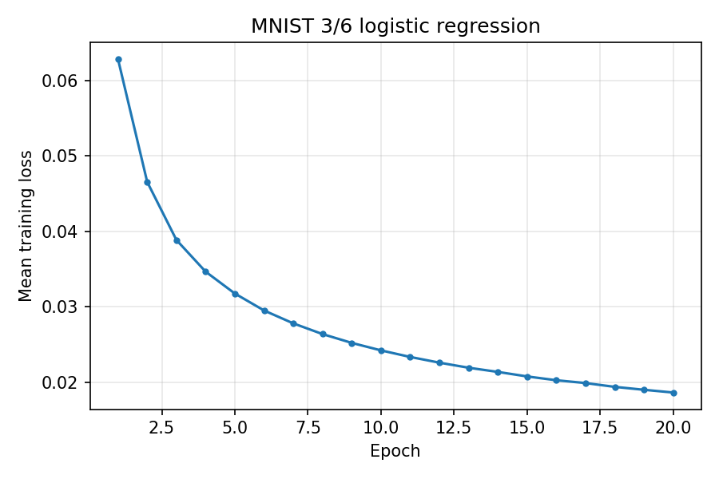
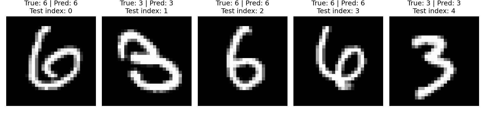

# 1. 实验内容

## 1.1 实验任务与数据集

本实验要求在不借助现成分类器、自动求导框架和现成优化器的条件下，用 Python 与 NumPy 从零实现逻辑回归，完成 MNIST 手写数字中“3”与“6”的二分类。具体目标有三项：一是掌握二分类逻辑回归的建模方式，即先用线性分数 $z=\boldsymbol{\omega}^{\top}\boldsymbol{x}$ 把 785 维输入压缩成一个实数，再用 sigmoid 把它解释为正类概率；二是掌握由最大似然导出负对数似然损失、再对参数求梯度、最后用梯度下降更新参数的完整推导；三是把上述推导逐条落实到 NumPy 的数组运算上，得到可运行、可复现的训练与评估程序。Matplotlib 只承担绘图工作，不参与任何模型计算。

实验数据为 MNIST 手写数字数据集，程序直接读取项目内已下载的文件 data/mnist_data/mnist.npz。该文件保存官方划分的 60000 个训练样本和 10000 个测试样本。程序只取出标签为 3 和 6 的样本，丢弃其余八个数字，筛选后两类的数量见表 1。

**表 1 筛选后数字 3 与数字 6 的样本数量**

| 集合 | 数字 3 | 数字 6 | 合计 |
| --- | --- | --- | --- |
| 训练集 | 6131 | 5918 | 12049 |
| 测试集 | 1010 | 958 | 1968 |

原始图像为 28×28 的灰度图，每个像素是 0～255 的整数，一幅图像共 784 个像素。两类样本的数量并不相等，训练集中数字 6 比数字 3 少 213 个，测试集中数字 6 比数字 3 少 52 个，这种轻微的类别不平衡在数据筛选后自然保留，实验没有做重采样处理。

数据划分方面：训练集只用于参数更新和每轮指标的记录；测试集在全部 20 轮训练完成后才被使用，用于按式(9)计算准确率并抽取样本展示，既不参与参数更新，也没有参与学习率、批大小、训练轮数的选择——这三个量都是程序中写定的常量。因此测试集给出的准确率可以看作模型在这批固定数据上的评测结果，而不是模型选择过程中的中间量。

## 1.2 数据预处理

预处理分两步完成：加载函数 load_binary_mnist 负责读取、筛选、展开和归一化，主程序负责标签转换和追加常数特征。整体数据流为：原始 (28,28) 的 uint8 图像 → 筛选 3/6 两类 → 展开为 784 维 → 除以 255 归一化 → 得到 0/1 标签 → 转换为 −1/+1 标签 → 追加常数特征 1 → 送入训练。

（1）**读取与筛选。** 调用 load_binary_mnist(3, 6)。函数用布尔掩码 (y_train == 3) | (y_train == 6) 同时保留两类样本，对训练集与测试集分别执行，因而官方划分在筛选后仍然保持不变。

（2）**展开为向量。** 每张 28×28 图像经 reshape(-1, 28*28) 成为 784 维向量，像素按行优先顺序排列。展开后图像的空间结构不再显式保留，784 个像素直接作为 784 个特征参与线性组合。

（3）**归一化。** 数组先转换为 float32，再整体除以 255.0，使每个特征的取值落在 [0,1] 区间。这样做的原因是：像素原始尺度为 0～255，若直接输入，785 维线性组合 $z=\boldsymbol{\omega}^{\top}\boldsymbol{x}$ 的数值会很大，sigmoid 迅速饱和到 0 或 1，输出对参数的导数接近 0，梯度下降几乎没有效果；归一化后各特征处于同一尺度，分数 $z$ 的量级可控，训练更稳定。

（4）**标签转换。** 加载函数返回 0/1 标签（数字 3 对应 0，数字 6 对应 1）；主程序用 np.where(y_train == 0, -1, +1) 把它转换成 −1/+1：数字 3 → $y=-1$，数字 6 → $y=+1$。此后损失与梯度都在这套 ±1 标签下计算。

（5）**合并偏置。** 用 np.column_stack 在每个样本末尾追加一个常数 1，样本变为 $\boldsymbol{x}=(x_1,\dots,x_{784},1)^{\top}$，参数变为 $\boldsymbol{\omega}=(w_1,\dots,w_{784},b)^{\top}$，其中最后一位 $b$ 就是偏置。这样式(1)的点积 $\boldsymbol{\omega}^{\top}\boldsymbol{x}$ 自动把偏置算了进去，程序中不需要为 $b$ 单独写一条更新式，也不会出现“偏置不更新”的错误。

（6）**形状核对。** 预处理完成后主要数组的形状见表 2。其中 (12049,) 是一维数组的写法（逗号是 Python 单元素元组的语法），不是 12049 行的列向量；正因为 $y$ 是一维数组，后面的 y_batch * z 才能按样本逐元素相乘。

**表 2 预处理后主要数组的形状与含义**

| 数组 | 形状 | 含义 |
| --- | --- | --- |
| X_train | (12049, 785) | 12049 个训练样本，784 个像素特征加 1 个常数特征 |
| y_train | (12049,) | 训练样本标签，取值 −1（数字 3）或 +1（数字 6） |
| X_test | (1968, 785) | 1968 个测试样本的特征 |
| y_test | (1968,) | 测试样本标签，取值 −1（数字 3）或 +1（数字 6） |
| $\boldsymbol{\omega}$ | (785,) | 784 个像素权重加偏置 b |

## 1.3 模型原理

**符号约定。** 第 $i$ 个样本的 785 维特征记为列向量 $\boldsymbol{x}_i$（最后一个分量恒为常数 1），参数记为列向量 $\boldsymbol{\omega}$（最后一个分量为偏置 $b$），二者都取自 $\mathbb{R}^{785}$；上标 $\top$ 表示转置，因此 $\boldsymbol{\omega}^{\top}\boldsymbol{x}_i$ 是一个实数。标签 $y_i\in\{-1,+1\}$；$n$ 为训练集样本数（12049），$m$ 为一个批次内的样本数（不超过 128），$\eta>0$ 为学习率。行文中变量用斜体，函数名与算子名（$\ln$、$\sigma$、$\nabla$）用正体。

**线性分数。** 模型先对 785 维输入做内积，得到一个实数分数 $z_i$：

$$
z_i=\boldsymbol{\omega}^{\top}\boldsymbol{x}_i \qquad (1)
$$

分数 $z_i$ 的符号表示样本落在决策边界的哪一侧：$z_i>0$ 为参数所指的正侧，$z_i<0$ 为负侧；$|z_i|$ 越大，样本离边界越远。把 $b$ 与 784 个权重一起放进 $\boldsymbol{\omega}$、把常数 1 放进 $\boldsymbol{x}_i$，式(1)就把偏置自动包含在内。

**sigmoid 函数。** $\sigma$ 把实数压缩到开区间 $(0,1)$，其输出可解释为正类（数字 6）的概率：

$$
\sigma(z)=\frac{1}{1+e^{-z}} \qquad (2)
$$

它满足 $\sigma(-z)=1-\sigma(z)$ 与 $\sigma(0)=1/2$ 两个性质。第一个性质在把梯度写成等价形式时要用到；第二个性质说明零分数对应两类各占一半的不确定状态。$\sigma$ 在 $\mathbb{R}$ 上严格单调递增，所以 $z$ 越大正类概率越大，按 $1/2$ 判决与按 $z$ 的符号判决完全等价。

**类别条件概率。** 记数字 6 为正类、数字 3 为负类，则给定特征与参数时两类的条件概率为：

$$
P(Y=+1\mid \boldsymbol{x};\boldsymbol{\omega})=\sigma(\boldsymbol{\omega}^{\top}\boldsymbol{x}) \\
P(Y=-1\mid \boldsymbol{x};\boldsymbol{\omega})=1-\sigma(\boldsymbol{\omega}^{\top}\boldsymbol{x}) \\
P(Y=y\mid \boldsymbol{x};\boldsymbol{\omega})=\sigma(y\,\boldsymbol{\omega}^{\top}\boldsymbol{x}) \qquad (3)
$$

第三行把两种情形合并成一个式子：$y=+1$ 时它等于 $\sigma(\boldsymbol{\omega}^{\top}\boldsymbol{x})$，$y=-1$ 时由 $\sigma(-z)=1-\sigma(z)$ 等于 $1-\sigma(\boldsymbol{\omega}^{\top}\boldsymbol{x})$。这一合并写法使似然可以只写一个连乘式，也是本实验统一采用 $\pm 1$ 标签的直接原因。

**条件似然。** 若样本之间条件独立，则训练集在给定特征条件下的似然是各样本真实类别概率的连乘：

$$
\mathcal{L}(\boldsymbol{\omega})=\prod_{i=1}^{n}\sigma\left(y_i\,\boldsymbol{\omega}^{\top}\boldsymbol{x}_i\right) \qquad (4)
$$

其中 $\mathcal{L}$ 记似然函数，以便与后面的平均损失 $L$ 区分。

**负对数似然与平均损失。** 式(4)是 $n$ 个概率的连乘，数值上很小、且随 $n$ 增大迅速下溢，所以先取对数把乘积化为求和；再由“最大化似然”与“最小化负对数似然”等价，得到单样本损失与平均损失：

$$
\ell_i(\boldsymbol{\omega})=\ln\left(1+e^{-y_i\,\boldsymbol{\omega}^{\top}\boldsymbol{x}_i}\right) \\
L(\boldsymbol{\omega})=\frac{1}{n}\sum_{i=1}^{n}\ell_i(\boldsymbol{\omega}) \qquad (5)
$$

其中 $\ln$ 表示自然对数。第一行由 $\sigma(yz)=1/(1+e^{-yz})$ 取负对数直接得到。对于确定的类别标签，该损失就是交叉熵：交叉熵等于真实类别对数概率的相反数 $-\ln\sigma(y_i z_i)$，而 $-\ln\sigma(y_i z_i)=\ln(1+e^{-y_i z_i})$。也就是说，负对数似然损失在二分类情形下就是交叉熵，两者只是从不同角度写同一个量。

**梯度。** 对式(5)的单样本损失求关于 $\boldsymbol{\omega}$ 的梯度，先对分数 $z_i$ 求导，再用链式法则相乘：

$$
\frac{\partial \ell_i}{\partial z_i}=-y_i\,\sigma(-y_i z_i) \\
\frac{\partial z_i}{\partial \boldsymbol{\omega}}=\boldsymbol{x}_i \\
\frac{\partial \ell_i}{\partial \boldsymbol{\omega}}=-y_i\,\sigma(-y_i z_i)\,\boldsymbol{x}_i
$$

**负号的来源。** $\ell_i$ 是复合函数：外层 $\ln$ 对括号内的量求导得 $1/(1+e^{-y_i z_i})$，内层 $-y_i z_i$ 对 $z_i$ 求导得 $-y_i$，两者相乘得 $-y_i e^{-y_i z_i}/(1+e^{-y_i z_i})=-y_i\sigma(-y_i z_i)$。负号来自内层的 $-y_i z_i$，不能遗漏；若在代码中漏掉这个负号，更新方向会反过来，训练时损失将上升而不是下降。

对一个含 $m$ 个样本的小批量取平均，得到程序中实际使用的梯度：

$$
\nabla L(\boldsymbol{\omega})=-\frac{1}{m}\sum_{i=1}^{m}y_i\,\sigma(-y_i\,\boldsymbol{\omega}^{\top}\boldsymbol{x}_i)\,\boldsymbol{x}_i \\
=-\frac{1}{m}\sum_{i=1}^{m}\left[1-\sigma(y_i\,\boldsymbol{\omega}^{\top}\boldsymbol{x}_i)\right]y_i\,\boldsymbol{x}_i \qquad (6)
$$

第二行由 $\sigma(-u)=1-\sigma(u)$ 换元得到，两行数值完全相同，本实验的代码采用第一行。第二行的形式可以看出梯度的直观含义：$\sigma(y_i z_i)$ 是真实类别的预测概率，它越接近 1（样本被判得越准），$1-\sigma(y_i z_i)$ 越接近 0，该样本对梯度的贡献也越小。

**参数更新。** 用上标 $(t)$ 表示第 $t$ 次更新后的参数，沿负梯度方向走一步，步长由学习率 $\eta$ 控制：

$$
\boldsymbol{\omega}^{(t+1)}=\boldsymbol{\omega}^{(t)}-\eta\,\nabla L(\boldsymbol{\omega}^{(t)}) \qquad (7)
$$

**分类决策。** 训练结束后对每个样本计算正类概率 $p_i$，再按 $1/2$ 阈值判决：

$$
p_i=\sigma(\boldsymbol{\omega}^{\top}\boldsymbol{x}_i) \\
\hat{y}_i=\begin{cases}+1, & p_i\ge 1/2\\ -1, & p_i<1/2\end{cases} \qquad (8)
$$

最后把 $\hat{y}_i=+1$ 映射回数字 6、$\hat{y}_i=-1$ 映射回数字 3。程序直接比较概率与 0.5，与上式一致；按 $1/2$ 判决的好处是判决过程与概率解释共用一套符号，也便于直接检查 p_positive 的数值。

**准确率。** 设样本总数为 $N$，预测正确的样本数为 $N_{\mathrm{correct}}$，则

$$
\mathrm{accuracy}=\frac{N_{\mathrm{correct}}}{N_{\mathrm{total}}} \\
N_{\mathrm{correct}}=\sum_{i=1}^{N}\mathbf{1}\left[\hat{y}_i=y_i\right] \qquad (9)
$$

其中 $\mathrm{1}[\cdot]$ 为指示函数，方括号内的条件成立时取 1、否则取 0；$N_{\mathrm{total}}$ 为样本总数（训练集 12049，测试集 1968）。式(9)就是“预测正确的样本数除以样本总数”。

## 1.4 训练设置与训练流程

超参数在程序开头以常量形式给出，本次运行使用的取值见表 3。

**表 3 训练超参数的取值与作用**

| 参数 | 取值 | 在式中的位置与作用 |
| --- | --- | --- |
| learning_rate | 0.1 | 式(7)中的步长 $\eta$，固定不衰减 |
| batch_size | 128 | 式(6)中 m 的上限，一次参数更新所用的样本数 |
| epochs | 20 | 训练集完整遍历的轮数，固定不变，无早停 |
| random_seed | 42 | 随机数发生器的种子，控制参数初始化与每轮打乱 |

此外程序用 DIGIT_NEGATIVE 与 DIGIT_POSITIVE 两个常量指定参与分类的两个数字，本次取 3 与 6。

训练流程按程序执行顺序说明如下。

（1）**参数初始化。** 用 np.random.default_rng(42) 建立随机数发生器，再用 rng.normal(0.0, 0.01, size=785) 生成 $\boldsymbol{\omega}$，即 785 个均值为 0、标准差为 0.01 的随机数。取很小的标准差有两个考虑：一是打破各参数取值的对称性，否则所有分量相同会让更新沿对称方向进行；二是使初始分数 $z$ 接近 0，$\sigma(z)\approx 0.5$，不落入 sigmoid 的饱和区。程序在训练前用初始参数对整个训练集算了一次平均损失，得到 0.70416189，与 $\sigma(0)=0.5$ 时的理论值 $-\ln 0.5\approx 0.693147$ 很接近，说明初始化确实落在预期位置。

（2）**每轮打乱。** 每个 epoch 开始时调用 rng.permutation(n) 得到一个 12049 维的随机排列 order，再用同一个 order 同时索引 X 和 y（X_shuffled = X[order]，y_shuffled = y[order]），保证打乱后图像与标签仍然一一对应。打乱的目的是让每个批次的样本组合在轮与轮之间不同，避免固定的样本顺序给批次梯度带来系统性偏差。

（3）**划分小批量并逐批更新。** 按 batch_size=128 从打乱后的数据上顺序切片，每个批次依次计算分数 $z$、每个样本的系数 coefficient、批平均梯度 gradient，然后更新一次 $\boldsymbol{\omega}$。由于 12049=94×128+17，每轮共有 95 个批次，最后一个批次只有 17 个样本；该批次同样参与训练，求平均时除以实际的 $m=17$，而不是补零或直接丢弃。

（4）**每轮结束记录指标。** 一轮中所有批次都更新完毕后，用该轮结束时的同一组 $\boldsymbol{\omega}$ 对整个训练集（12049 个样本）重新计算平均损失和准确率，打印并追加到 history。注意这两个指标不是“各批次指标的算术平均”，而是在整轮结束后对全量训练数据的一次重新计算。

（5）**结束。** 固定训练 20 轮后停止，既没有早停，也没有学习率衰减或任何调度。因为每轮 95 次参数更新，20 轮共 95×20=1900 次参数更新。

**三个概念的层次关系。** epoch 指整个训练集完整参与一次训练，本实验共 20 个；batch_size 指一次梯度计算所用的样本数上限，这里是 128；一次参数更新指取一个批次、算一次梯度、把 $\boldsymbol{\omega}$ 修改一次。1 个 epoch 包含 95 次参数更新，20 个 epoch 包含 1900 次参数更新，三者不是同一层次的概念，不能混用。例如“训练了 20 次”应当说成“训练了 20 轮、共 1900 次参数更新”。

# 2. 实验代码

## 2.1 代码组织

程序由两个文件组成，都在 src/ 目录下。src/load_data.py 负责读取 data/mnist_data/mnist.npz、筛选数字 3 和 6、把每张 28×28 图像展开成 784 维并归一化，返回 0/1 标签；src/luojihuigui.py 负责把标签转换为 ±1、追加常数特征、训练参数、评估并保存结果。在项目根目录执行 python src/luojihuigui.py 即可运行，脚本所在目录会自动加入模块搜索路径。核心计算只用 NumPy，Matplotlib 仅在 save_figures 内部导入并设为 Agg 后端，只用于绘图。两个文件末尾的 if __name__ == "__main__": 块只在直接运行该文件时执行。

## 2.2 src/load_data.py

**（1）函数定义与参数检查。** 定义唯一的数据加载函数，并检查两个数字参数不能相同、必须落在 0～9 之间。

```python
from pathlib import Path

import numpy as np


def load_binary_mnist(digit_0, digit_1):
    """提取两个数字：digit_0 的标签设为 0，digit_1 的标签设为 1。"""
    if digit_0 == digit_1:
        raise ValueError("请选择两个不同的数字")

    if digit_0 not in range(10) or digit_1 not in range(10):
        raise ValueError("数字必须在 0～9 之间")
```

**（2）读取数据文件。** 以本文件位置定位项目根目录，从 mnist.npz 中读出四个数组。

```python
    data_path = (
        Path(__file__).resolve().parent.parent
        / "data"
        / "mnist_data"
        / "mnist.npz"
    )

    with np.load(data_path) as data:
        x_train = data["x_train"]
        y_train = data["y_train"]
        x_test = data["x_test"]
        y_test = data["y_test"]
```

**（3）筛选两类样本。** 用布尔掩码保留标签为 0 或 1 的样本，训练集与测试集各做一次。

```python
    # 1. 筛选指定两个数字的样本
    train_mask = (y_train == digit_0) | (y_train == digit_1)
    test_mask = (y_test == digit_0) | (y_test == digit_1)

    x_train = x_train[train_mask]
    y_train = y_train[train_mask]
    x_test = x_test[test_mask]
    y_test = y_test[test_mask]
```

**（4）转换标签为 0/1。** 原数字标签映射为二分类标签：digit_1 记为 1，digit_0 记为 0。

```python
    # 2. 将原数字标签转换为二分类标签
    # digit_0 → 0，digit_1 → 1
    y_train = (y_train == digit_1).astype(np.float32)
    y_test = (y_test == digit_1).astype(np.float32)
```

**（5）展开与归一化。** 每张 28×28 图像展平成 784 维向量，再由 uint8 转成 float32 并除以 255。

```python
    # 3. 每张图片展开成 784 个特征，并将像素值从 0～255 缩放到 0～1
    x_train = x_train.reshape(-1, 28 * 28).astype(np.float32) / 255.0
    x_test = x_test.reshape(-1, 28 * 28).astype(np.float32) / 255.0

    return x_train, y_train, x_test, y_test
```

这段构造的是式(1)中的输入向量：$\boldsymbol{x}_i$ 的 784 个分量在此展开并缩放到 $[0,1]$。

**（6）单独运行时的演示入口。** 仅在直接运行本文件时执行，演示的是数字 3 和 7，只打印形状，不影响主程序。

```python
if __name__ == "__main__":
    x_train, y_train, x_test, y_test = load_binary_mnist(3, 7)

    print("训练集特征形状：", x_train.shape)
    print("训练集标签形状：", y_train.shape)
    print("测试集特征形状：", x_test.shape)
    print("测试集标签形状：", y_test.shape)
    print("前 10 个训练标签：", y_train[:10])
```

## 2.3 src/luojihuigui.py

**（1）导入、超参数、类别常量与路径。** 把学习率、批大小、轮数、随机种子写成常量，用两个常量指定参与分类的数字，并算出输出目录。

```python
"""用 NumPy 从零实现 MNIST 数字 3/6 的二分类逻辑回归。"""

from pathlib import Path

import numpy as np

from load_data import load_binary_mnist

# 学习率和固定训练轮数仅由训练设置决定，不根据测试集调整。
LEARNING_RATE = 0.1
BATCH_SIZE = 128
EPOCHS = 20
RANDOM_SEED = 42
DIGIT_NEGATIVE = 3  # 标签 -1 对应的原始数字
DIGIT_POSITIVE = 6  # 标签 +1 对应的原始数字

PROJECT_ROOT = Path(__file__).resolve().parent.parent
OUTPUT_DIR = PROJECT_ROOT / "outputs"
```

LEARNING_RATE 是式(7)中的 $\eta$，BATCH_SIZE 是式(6)中 $m$ 的上限；DIGIT_NEGATIVE=3 与 DIGIT_POSITIVE=6 指定两类对应的数字，其中数字 6 记为正类（$y=+1$）、数字 3 记为负类（$y=-1$）。

**（2）数值稳定的 sigmoid。** 按输入正负分两支计算同一个 sigmoid，使 exp 的自变量不大于 0。

```python
def sigmoid(z):
    """同一个 sigmoid 公式按正负分开计算，避免 exp 的指数溢出。"""
    z = np.asarray(z, dtype=np.float64)
    probability = np.empty_like(z)
    positive = z >= 0
    probability[positive] = 1.0 / (1.0 + np.exp(-z[positive]))
    exp_z = np.exp(z[~positive])
    probability[~positive] = exp_z / (1.0 + exp_z)
    return probability
```

这段实现式(2)：$z\ge 0$ 时用 $1/(1+e^{-z})$，$z<0$ 时用 $e^{z}/(1+e^{z})$，两式等价，指数都不会溢出。

**（3）训练函数的初始化。** 建立随机数发生器、生成参数、算出训练前的初始损失。

```python
def train(X, y):
    """PPT：每个 epoch 打乱样本，然后逐个小批量计算梯度、更新参数。"""
    rng = np.random.default_rng(RANDOM_SEED)
    n, feature_count = X.shape                           # X: (n, 785)，y: (n,)
    omega = rng.normal(0.0, 0.01, size=feature_count)      # omega: (785,)
    initial_loss = np.mean(np.logaddexp(0.0, -y * (X @ omega)))
    history = []
    batches_per_epoch = (n + BATCH_SIZE - 1) // BATCH_SIZE
    print(f"\n训练设置：learning_rate={LEARNING_RATE}，batch_size={BATCH_SIZE}，"
          f"epochs={EPOCHS}，seed={RANDOM_SEED}")
    print(f"omega.shape={omega.shape}；每轮 {batches_per_epoch} 次参数更新；"
          f"最后一批 {n - (batches_per_epoch - 1) * BATCH_SIZE} 个样本")
    print(f"初始化时整个训练集的平均损失：{initial_loss:.8f}")
```

$\boldsymbol{\omega}$ 按 $N(0,0.01^2)$ 初始化，即式(1)的参数；initial_loss 是式(5)在初始参数下的整集平均。

**（4）每轮打乱与划分小批量。** 每个 epoch 用同一排列索引 X 和 y，再以 128 为步长切片。

```python
    for epoch in range(1, EPOCHS + 1):
        # 对 X 和 y 使用同一排列，保持图片和标签一一对应。
        order = rng.permutation(n)
        X_shuffled = X[order]
        y_shuffled = y[order]
        for start in range(0, n, BATCH_SIZE):
            X_batch = X_shuffled[start:start + BATCH_SIZE]  # (m, 785)
            y_batch = y_shuffled[start:start + BATCH_SIZE]  # (m,)
            m = len(y_batch)  # 最后一批也参与训练，并除以实际样本数 m。
```

$m$ 取批次的实际样本数，供式(6)求平均，使只有 17 个样本的最后一批不被低估。

**（5）批次内的分数、梯度与参数更新。** 四行依次对应式(1)、式(6)、式(6)、式(7)。

```python
            z = X_batch @ omega                         # (m,)，z_i = omega^T x_i
            # 正确梯度：-(1/m) sum[y_i x_i sigmoid(-y_i z_i)]。

            coefficient = -y_batch * sigmoid(-y_batch * z)  # (m,)
            gradient = X_batch.T @ coefficient / m       # (785,)
            omega = omega - LEARNING_RATE * gradient     # (785,)，沿负梯度更新
```

**（6）每轮结束时的指标计算与记录。** 用当前参数对整个训练集重算分数、损失、预测与准确率。

```python
        # 使用本轮结束时的同一组参数，对整个训练集重新计算指标。
        # logaddexp(0, -yz) = log(exp(0) + exp(-yz)) = log(1 + exp(-yz))。
        z = X @ omega                                   # (n,)
        loss = np.mean(np.logaddexp(0.0, -y * z))
        prediction = np.where(sigmoid(z) >= 0.5, +1, -1)
        accuracy = np.mean(prediction == y)
        history.append((epoch, loss, accuracy))
        print(f"Epoch {epoch:02d}/{EPOCHS} | 训练平均损失={loss:.8f} | "
              f"训练准确率={accuracy:.4%}")

    print(f"训练总体损失：{initial_loss:.8f} -> {history[-1][1]:.8f}")
    return omega, np.asarray(history)
```

np.logaddexp(0.0, −yz) 就是式(5)中的 $\ln(1+e^{-yz})$；prediction 与 accuracy 对应式(8)与式(9)。

**（7）绘图与保存。** 把损失曲线和 5 张测试样本保存为 PNG；绘图前只取前 784 维，因为最后一维是常数 1，不是像素。

```python
def save_figures(history, X_test, y_test, indices, predicted_digits):
    """Matplotlib 只负责画图；保存 PNG，在没有图形界面的环境也能运行。"""
    import matplotlib
    matplotlib.use("Agg")
    import matplotlib.pyplot as plt

    fig, ax = plt.subplots(figsize=(6, 4))
    ax.plot(history[:, 0], history[:, 1], marker="o", markersize=3)
    ax.set(xlabel="Epoch", ylabel="Mean training loss", title=f"MNIST {DIGIT_NEGATIVE}/{DIGIT_POSITIVE} logistic regression")
    ax.grid(alpha=0.3)
    fig.tight_layout()
    fig.savefig(OUTPUT_DIR / "training_loss.png", dpi=150)
    plt.close(fig)

    fig, axes = plt.subplots(1, len(indices), figsize=(12, 3))
    for ax, index, predicted_digit in zip(axes, indices, predicted_digits):
        # 最后一个特征是偏置用的 1，画图时只取前 784 个像素。
        ax.imshow(X_test[index, :784].reshape(28, 28), cmap="gray", vmin=0, vmax=1)
        true_digit = DIGIT_POSITIVE if y_test[index] == +1 else DIGIT_NEGATIVE
        ax.set_title(f"True: {true_digit} | Pred: {predicted_digit}\nTest index: {index}")
        ax.axis("off")
    fig.tight_layout()
    fig.savefig(OUTPUT_DIR / "test_predictions.png", dpi=150)
    plt.close(fig)
```

**（8）主程序：数据准备与训练。** 取两类数据、转换标签、追加常数特征，训练 20 轮并写入 CSV。

```python
def main():
    OUTPUT_DIR.mkdir(parents=True, exist_ok=True)
    # 复用已有函数：筛选指定数字、展开成 784 维、除以 255。
    X_train, y_train, X_test, y_test = load_binary_mnist(DIGIT_NEGATIVE, DIGIT_POSITIVE)

    # 加载函数返回 0/1 标签；转换为损失和梯度使用的 -1/+1 标签。
    y_train = np.where(y_train == 0, -1, +1)             # (n_train,)
    y_test = np.where(y_test == 0, -1, +1)               # (n_test,)
    # x = [x1, ..., x784, 1]，最后一个参数就是偏置 b。
    X_train = np.column_stack((X_train, np.ones(len(X_train))))  # (n_train, 785)
    X_test = np.column_stack((X_test, np.ones(len(X_test))))     # (n_test, 785)

    for name, X, y in (("训练集", X_train, y_train), ("测试集", X_test, y_test)):
        print(f"{name}：{len(y)} 个样本；数字 {DIGIT_NEGATIVE} / y=-1：{np.sum(y == -1)}；"
              f"数字 {DIGIT_POSITIVE} / y=+1：{np.sum(y == 1)}")
        print(f"  X.shape={X.shape}，y.shape={y.shape}")

    omega, history = train(X_train, y_train)
    np.savetxt(OUTPUT_DIR / "training_history.csv", history, delimiter=",",
               header="epoch,train_loss,train_accuracy", comments="", fmt=["%d", "%.12f", "%.12f"])
```

标签在此由 0/1 转成 $\pm1$（式(3)）；末尾追加的常数 1 使 $\boldsymbol{\omega}^{\top}\boldsymbol{x}$ 自动包含偏置（式(1)）。

**（9）主程序：训练集与测试集评估。** 先在整个训练集上算一次准确率，再对测试集判决。

```python
    train_prediction = np.where(sigmoid(X_train @ omega) >= 0.5, +1, -1)
    train_correct = np.sum(train_prediction == y_train)
    print(f"\n最终训练集准确率：{train_correct / len(y_train):.4%}（{train_correct}/{len(y_train)}）")

    # 训练结束后才使用测试集；不对 omega 更新，也不根据测试结果调整超参数。
    p_positive = sigmoid(X_test @ omega)                 # (n_test,)
    prediction = np.where(p_positive >= 0.5, +1, -1)      # (n_test,)
    correct = np.sum(prediction == y_test)
    print(f"\n最终测试集准确率：{correct / len(y_test):.4%}（{correct}/{len(y_test)}）")

    # 从已完成的预测中取前 5 个结果，用于展示测试图片。
    indices = np.arange(5)
    predicted_digits = np.where(prediction[indices] == +1, DIGIT_POSITIVE, DIGIT_NEGATIVE)
    save_figures(history, X_test, y_test, indices, predicted_digits)
    print(f"\n训练曲线、测试图片和 CSV 已保存到：{OUTPUT_DIR}")
```

这里用的是式(8)的阈值判决与式(9)的准确率；测试集只在此处出现，不参与参数更新。

**（10）程序入口。** 只有直接运行本文件时才调用 main()。

```python
if __name__ == "__main__":
    main()
```

## 2.4 核心训练代码的展开

训练的核心是下面四行，位于 train 函数的批次循环内部：

```python
z = X_batch @ omega                              # (m,)，z_i = omega^T x_i
coefficient = -y_batch * sigmoid(-y_batch * z)    # (m,)
gradient = X_batch.T @ coefficient / m           # (785,)
omega = omega - LEARNING_RATE * gradient         # (785,)，沿负梯度更新
```

四行中各个量的形状见表 4。

**表 4 核心四行中变量的形状与含义**

| 变量 | 形状 | 含义与对应公式 |
| --- | --- | --- |
| X_batch | (m, 785) | 一个批次的样本，m≤128 |
| y_batch | (m,) | 该批次的 −1/+1 标签 |
| omega | (785,) | 当前参数，含偏置 |
| z | (m,) | 每个样本的线性分数，式(1) |
| coefficient | (m,) | 每个样本的 $-y_i\sigma(-y_i z_i)$，式(6) |
| gradient | (785,) | 批平均梯度，式(6) |

四行依次完成：算分数（式(1)）、算每个样本的系数（式(6)）、按样本加权求和得到梯度（式(6)）、沿负梯度更新参数（式(7)）。

## 2.5 数值稳定性处理

程序在三处做了数值稳定性处理，都是同一公式的等价变形。

（1）**sigmoid 分支。** $z\ge 0$ 时用 $1/(1+e^{-z})$，$z<0$ 时用 $e^{z}/(1+e^{z})$。后者是前者分子分母同乘 $e^{z}$ 的结果，两者在实数范围内相等。$z<0$ 时 $e^{-z}$ 会随 $|z|$ 增大而急剧增长，可能溢出为 inf；改写后两支中 exp 的自变量都不大于 0，指数结果落在 $(0,1]$。

（2）**损失用 np.logaddexp。** np.logaddexp(0, −yz) 计算 $\ln(e^{0}+e^{-yz})=\ln(1+e^{-yz})$，正是式(5)的单样本损失。它先取较大项再取对数，避免直接计算 $1+e^{-yz}$ 时有效数字丢失。

（3）**不连乘概率。** 式(4)是 12049 个概率的连乘，连乘后必然下溢为 0，取对数只能得到 −inf。程序从不在数值上构造式(4)，而是直接对式(5)求和再取平均。

# 3. 实验结果与结果分析

## 3.1 实际运行指标

本次运行的终端输出保存在 outputs/run_log.txt，逐轮指标保存在 outputs/training_history.csv。

**表 5 本次运行的关键指标**

| 指标 | 数值 | 来源 |
| --- | --- | --- |
| 初始化训练平均损失 | 0.70416189 | 运行日志 |
| 第 1 轮结束时训练平均损失 | 0.06285353 | CSV 与运行日志 |
| 第 20 轮结束时训练平均损失 | 0.01864255 | CSV 与运行日志 |
| 第 20 轮训练准确率 | 99.4771% | CSV 与运行日志 |
| 训练集正确分类数 | 11986 | 运行日志 |
| 测试集正确分类数 | 1955 | 运行日志 |
| 测试集样本总数 | 1968 | 运行日志 |
| 测试集准确率 | 99.3394% | 按式(9)计算 |
| 测试集误分类数 | 13 | 1968−1955 |

测试集准确率按式(9)计算：

$$
\mathrm{accuracy}=\frac{1955}{1968}\times 100\%\approx 99.3394\%
$$

第 20 轮的训练准确率 99.4771% 对应 12049 个训练样本中 11986 个判对、63 个判错（$12049\times(1-0.994771)\approx 63.0$）。

## 3.2 训练损失曲线



**图1 逻辑回归训练平均损失随训练轮数的变化**

图1 的横轴为训练轮数，纵轴为该轮结束时整个训练集的平均损失，纵轴范围约 0.019～0.063。

（1）损失从第 1 轮的 0.06285353 降到第 20 轮的 0.01864255，第 20 轮的值约为第 1 轮的 30%。前几轮下降快：第 1 到第 2 轮下降 0.01629，第 2 到第 3 轮下降 0.00770；最后几轮每轮只下降约 $3.6\times10^{-4}$，曲线明显变平。

（2）图中的第一个点是第 1 轮结束后的损失，不是训练开始前的初始化损失 0.70416189——后者没有画入图中。因此图1 反映的是 20 轮训练过程中的变化，下降幅度最大的部分其实发生在第 1 轮之内（从 0.704 到 0.063）。

（3）记录的是每轮结束时的整体指标，粒度较粗。训练准确率并非逐轮单调上升（例如第 9 轮 99.3443%、第 10 轮 99.3277%），说明轮级指标本身带有波动，不能要求每一步都改善，也不能据此宣称已达到全局最优或完全收敛。

## 3.3 测试集预测结果



**图2 部分测试样本的真实数字与预测结果**

图2 是测试集索引 0～4 的 5 个样本，每张图上方标注真实数字（True）与预测数字（Pred）。这 5 个样本的真实数字依次为 6、3、6、6、3，预测结果与之完全一致。

图2 只展示 1968 个测试样本中的 5 个，而且不是随机抽样，是固定取的前 5 个。99.3394% 是在全部测试样本上按式(9)计算的；展示的样本全部正确不能说明整个测试集全部正确，实际仍有 13 个样本被分错，这些样本的图像没有保存，无法分析其错分原因。

## 3.4 结果分析

（1）**模型能够完成本实验的分类任务。** 训练准确率 99.4771%、测试准确率 99.3394%，说明“线性分数 + sigmoid + 负对数似然 + 梯度下降”这套模型能够把数字 3 和数字 6 区分开。两个数字的笔画都由弧线构成，线性分类器仍能获得足够的判别信息。

（2）**训练有效的原因。** 像素归一化后 784 个特征处于同一尺度，式(1)的分数不会因像素量级而过大；20 轮内训练平均损失由 0.0629 持续降到 0.0186，说明式(6)的梯度符号与式(7)的负梯度方向是正确的——若 coefficient 少乘负号，损失会上升而不是下降。

（3）**测试准确率略低于训练准确率。** 99.3394% 低于 99.4771%，两者相差约 0.14 个百分点。参数在训练集上拟合，测试集是未参与训练的样本，测试准确率略低是常见情形；测试集只有 1968 个样本，13 个错分就占 0.66%。两者差距很小，没有明显过拟合的迹象。

（4）**准确率没有达到 100%。** 测试集有 13 个样本被分错，说明当前的线性决策边界并不能把两类完全分开；99.3394% 是本次运行在这批固定测试数据上的结果。

（5）**结论的适用范围。** 模型的分数是 785 维特征的线性组合，决策边界是一个超平面，不显式利用图像的二维结构。本实验只涉及数字 3 和 6 两类，结论不能推广到 MNIST 十分类问题，也不能推广到其他数字组合。

## 3.5 实验小结

本实验用 Python 与 NumPy 从零实现了逻辑回归：在 MNIST 数字 3/6 二分类任务上，训练集平均损失由 0.70416189 降到 0.01864255，训练准确率 99.4771%；测试集 1968 个样本中正确分类 1955 个，准确率 99.3394%。程序中的分数、损失、梯度、更新与评估分别对应式(1)、式(5)、式(6)、式(7)与式(8)(9)。测试集仍有 13 个样本被错分，模型仍是线性分类器，结论只适用于本实验的任务与数据范围。
